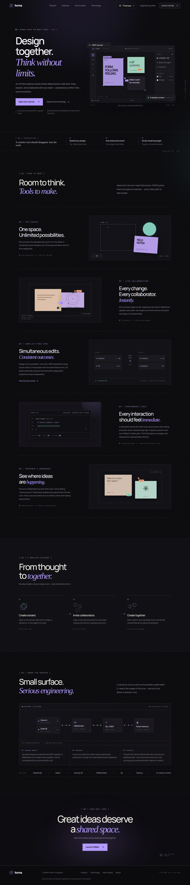
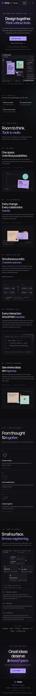
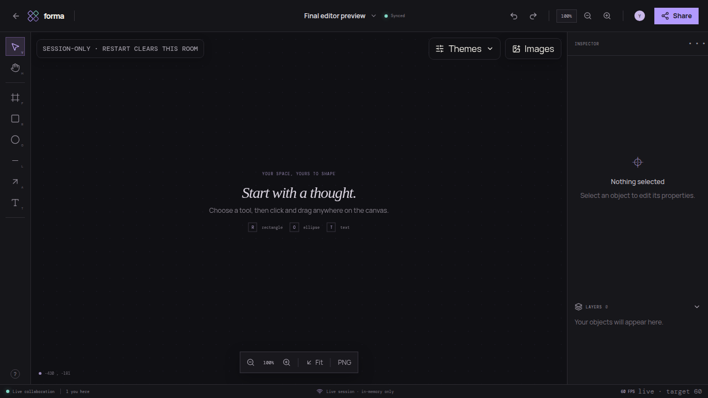
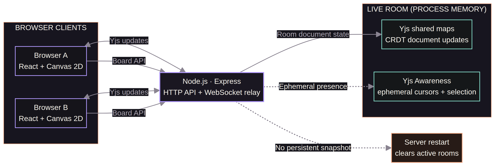

# FORMA — Ideas take shape. Together.

FORMA is a polished, anonymous collaborative canvas portfolio demo. Open a board, draw together in real time, share a high-entropy room link, and explore a responsive Canvas 2D editor. There is no login or account system and no application database: the server holds rooms only in memory. A server restart or deployment replacement clears active rooms. This is a deployable portfolio demo, **not production SaaS or durable cloud storage**.

## Preview








## Features

- Premium responsive landing page and live canvas UI with locally remembered themes: Electric Violet, Night Sky, Obsidian, Aurora, Forest, Ember, Paper, a Naruto-inspired Shinobi canvas backdrop, and a Demon Slayer-inspired Crimson Moon canvas backdrop. Choose them from **Themes** in the landing header or canvas action bar; the original full-canvas artworks are not character art or logos.
- Readable typography with Comfort, Large and Extra-large appearance controls; reduced-motion support; desktop precision plus compact mobile controls.
- Interactive Canvas 2D editor: frames, rectangles, ellipses, lines, arrows and text; multi-select, move, resize, rotate, color, stroke, opacity, text-size, undo/redo, keyboard shortcuts, zoom/pan and layers.
- Add an image from the device or search Wikimedia Commons. Images are compressed to a bounded payload and embedded in the live Yjs room. Edit fit, crop, brightness, contrast, saturation, opacity, size and rotation; view attribution/license/source, download the image, and export the board as JSON or the visible canvas as PNG.
- Real Yjs/WebSocket collaborative updates and ephemeral cursor/presence. Rooms are capped per server process and room links are randomly generated bearer capabilities.
- Canvas rendering is separated from React UI state, uses `requestAnimationFrame` and high-DPI scaling. The FPS indicator measures the loop; **60 FPS is a target, not a benchmarked guarantee**.

## Session and security model

The public room URL is the access capability: anyone who has the link can read and edit that room. Do not put confidential or sensitive material in a room. The server has no user identity, roles, private board ACL, durable database, image-object storage, shared history or autoscaling. It retains room state in process memory; a restart clears all active room content and sessions. A second server instance cannot see another instance's rooms. Imported/uploaded image payloads are bounded and live inside the room's Yjs document; they are not retained as a durable asset service. Only use images you have rights to use; Commons metadata is supplied by third parties and should be verified.

These are deliberate limits of the requested **no-account demo**. FORMA is not hardened for customer data, regulated use, private workspaces, enterprise identity, multi-instance SaaS, or durable production use. Do not describe it as SaaS-ready until authentication, authorization, durable storage, operational monitoring and deployment-specific security review are added.

## Architecture



Each canvas object is a Yjs shared map. CRDT updates merge across connected peers. Independent fields can update independently; simultaneous writes to the same scalar field converge according to Yjs's deterministic conflict ordering, not necessarily by wall-clock “last write wins.” Cursor awareness is ephemeral and not stored in the document. The Node/Express WebSocket relay holds rooms in memory and the HTTP API creates/renames active rooms.

See [architecture.mmd](./architecture.mmd) for the editable diagram source.

## Stack and local development

React, TypeScript, Vite, Tailwind CSS, Framer Motion, React Router, Lucide, HTML Canvas 2D, Yjs, Y Protocols, Node.js 22+, Express, `ws`, Vitest and pnpm. Versions are pinned in `package.json`/`pnpm-lock.yaml`. No app database URL, external provider credential, account secret or paid service is required.

```bash
pnpm install --frozen-lockfile
pnpm dev
```

Open `http://localhost:3000`. The Vite dev server proxies API and `/sync` WebSocket calls to the Node service. Create one board and open its share link in another browser/profile to exercise real-time collaboration. Rooms persist only for the lifetime of the server process.

## Checks

```bash
pnpm typecheck
pnpm test
pnpm build
pnpm test:integration # requires the development service to be running
pnpm benchmark
```

Unit tests cover geometry and Yjs convergence. The integration smoke test uses multiple WebSocket clients to exercise document sync and cross-room isolation. The geometry benchmark is not an FPS workload test. See `.github/workflows/ci.yml` for the repository CI checks.

## Container build

```bash
pnpm build
docker build -t forma:demo .
docker run --rm -p 3000:3000 forma:demo
```

Serve behind HTTPS with working WebSocket upgrades. Room state is process-local and disposable, so restarts/scale-out lose active rooms. Add identity, board authorization, durable storage, distributed room coordination, observability and independent security testing before evolving this demo into SaaS.

## Deploy the frontend on Vercel

The Vercel deployment serves the Vite frontend. The Node API and live WebSocket relay must run as a separate, long-lived web service: Vercel Functions do not support this app's persistent WebSocket connections or in-memory room state. A Render service definition is included in `render.yaml`; it uses the included Dockerfile.

1. Deploy this repository as a **Web Service** on Render using the `render.yaml` blueprint. Wait for the service health check to pass and copy its HTTPS URL.
2. Import the same repository into Vercel. Keep the project root at the repository root; `vercel.json` configures the Vite build and client-side routes.
3. In Vercel **Settings → Environment Variables**, set `VITE_BACKEND_URL` to the Render service URL (for example, `https://forma-backend.onrender.com`). Apply it to the environments you use, then redeploy.
4. Open the Vercel URL and create a board. Its share link can be opened on other devices; real-time collaboration works while the backend instance is awake and retains that room.

The included free Render plan may sleep when idle, and its in-memory rooms are lost when the service restarts or is replaced. This demo has no durable storage; for persistent boards or guaranteed uptime, use an always-on backend and add durable storage. Local development needs no environment variable because Vite proxies the API and WebSocket traffic to the local Node server.

## Third-party image sources

The Night Sky background uses a locally optimized Unsplash photo; attribution and license notes are in [docs/third-party-image-sources.md](./docs/third-party-image-sources.md). The image library queries the Wikimedia Commons Action API from the browser and displays source/creator/license metadata when available.

## Contributing

See [CONTRIBUTING.md](./CONTRIBUTING.md). Keep feature and security claims aligned with the working code, test collaboration semantics, and never commit board payloads, credentials or private data.
